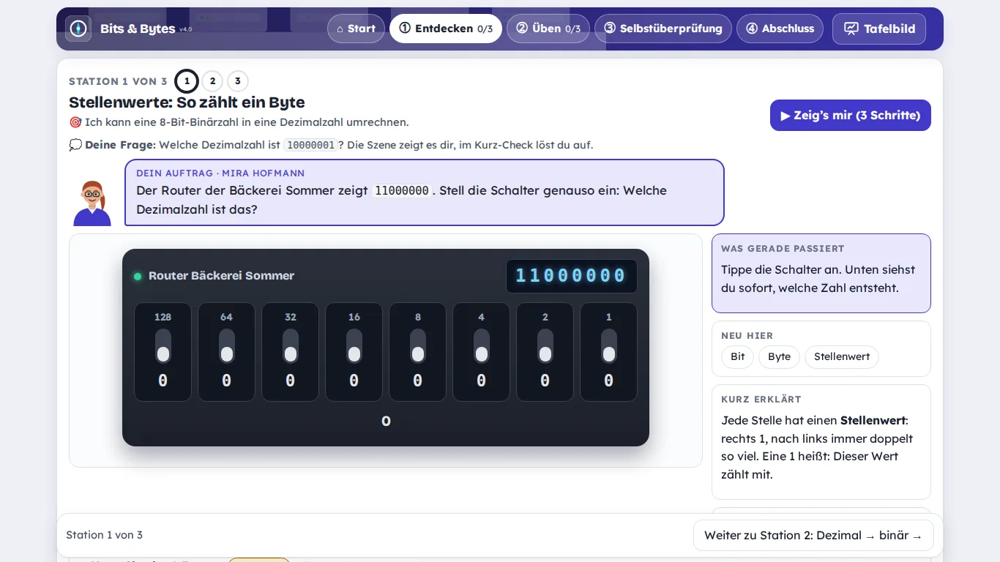
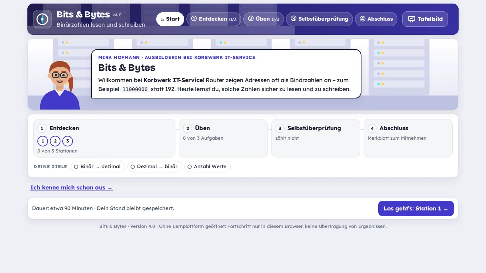

# Lernpaket-Kompass

Der Lernpaket-Kompass hilft Lehrkräften, interaktive Lernpakete für den eigenen Unterricht zu bauen. Er besteht aus zwei Teilen:

- einem **Leitfaden**, der beschreibt, was ein gutes Lernpaket ausmacht und wie es entsteht, und
- einem **Skill für die KI Claude**, der dich Schritt für Schritt durch Planung, Bau und Prüfung führt.

Programmierkenntnisse brauchst du nicht, und du musst auch keine Erfahrung mit KI-Werkzeugen mitbringen. Der Kompass ist für alle Fächer gedacht.

Aktueller Stand: **Kompass 4.0** (eine Versionsnummer für Leitfaden, Skill und Vorlage; sie steht in der Datei [`VERSION`](VERSION)).



*Eine Station aus dem Beispielpaket „Bits & Bytes“: Die Lernenden stellen die Schalter eines nachgebauten Routers ein und sehen sofort, welche Zahl entsteht.*

## Was ist ein Lernpaket?

Ein Lernpaket ist eine in sich geschlossene Lerneinheit zu einem Thema, die im Browser läuft. Die Lernenden lesen darin nicht nur, sie handeln: Sie bedienen ein nachgebautes Gerät, prüfen ein Dokument, führen ein Gespräch oder stellen etwas ein. Das Paket gibt Rückmeldung, die erklärt, warum eine Antwort richtig oder falsch ist.

Technisch ist ein Lernpaket eine ZIP-Datei im Format **SCORM 1.2**. Das ist ein verbreiteter Standard, den fast jede Lernplattform versteht, zum Beispiel Moodle, ILIAS oder die ByCS-Lernplattform der bayerischen Schulen. Du lädst die ZIP-Datei in deinem Kurs hoch, die Plattform zeigt das Paket an und speichert Fortschritt und Punktzahl.

Jedes Paket aus dem Kompass hat denselben Aufbau, damit sich Lernende sofort zurechtfinden:

| Teil | Was dort passiert |
|---|---|
| Start | Überblick: worum es geht, welche Ziele es gibt, wie lange es dauert |
| Entdecken | Stationen, an denen die Lernenden etwas ausprobieren; jede Station ist eine Szene zum Anfassen |
| Üben | Aufgaben mit gestuften Tipps |
| Selbstüberprüfung | Fragen am Ende. Sie zählen nicht und lassen sich beliebig oft wiederholen |
| Abschluss | Merkblatt zum Mitnehmen |
| Tafelbild | dieselben Bilder groß und ohne Erklärtext, für den Beamer im Unterricht |



## Was du hier findest

| | |
|---|---|
| **Anleitung für den Einstieg** | [docs/skill-set-anleitung.md](docs/skill-set-anleitung.md): Einrichten in etwa zehn Minuten, dann alle Arbeitsschritte mit Beispielsätzen, die du an Claude schreiben kannst |
| **Leitfaden** | [docs/leitfaden-lernpakete.md](docs/leitfaden-lernpakete.md): was die Lernforschung sagt, 13 Gestaltungsprinzipien (sieben davon sind Pflicht), Aufbau eines Pakets, Arbeitsablauf, technische Standards und eine Checkliste |
| **Wissenschaftliche Grundlagen** | [docs/wissenschaftliche-grundlagen.md](docs/wissenschaftliche-grundlagen.md): auf welche Forschung sich die Prinzipien stützen, wie belastbar sie ist und wo sie endet, erklärt ohne Fachsprache |
| **Skill zum Herunterladen** | `skill_lernpaket-kompass.zip` auf der [Downloadseite](https://dennismarcbusch.github.io/lernpaket-kompass/) oder unter [Releases](../../releases) |
| **Beispiele** | das Beispielpaket „Bits & Bytes“ (Vorlage für jedes neue Paket) und vier Beispiele zum Thema Handelsregister: die Simulation [„Partner-Check“](skills/lernpaket-bauen/beispiele/simulation-handelsregister.js), die Spiele [„Stempel drauf!“](skills/lernpaket-bauen/beispiele/spiel-stempel-drauf.js) und [„Firmendex“](skills/lernpaket-bauen/beispiele/spiel-firmendex.js) sowie eine [einzelne Station](skills/lernpaket-bauen/beispiele/wirtschaft-handelsregister.js) |

## In drei Schritten loslegen

Du brauchst ein Konto bei [Claude](https://claude.ai), in dem Claude Dateien erstellen und Code ausführen darf.

1. **Herunterladen:** die Datei `skill_lernpaket-kompass.zip` von der [Downloadseite](https://dennismarcbusch.github.io/lernpaket-kompass/) laden. Nicht entpacken und nicht umbenennen.
2. **In Claude hochladen:** *Customize → Skills → + → Create skill → Upload a skill*, die ZIP-Datei auswählen und den Skill einschalten.
3. **Losschreiben**, in normaler Sprache, zum Beispiel:

   > Ich möchte ein Lernpaket planen: Dreisatz für die Berufsintegrationsklasse, etwa 90 Minuten. Nutze den Lernpaket-Kompass.

Die [Anleitung](docs/skill-set-anleitung.md) beschreibt jeden Schritt ausführlich, auch das Hochladen des fertigen Pakets in die Lernplattform und häufige Probleme.

## So entsteht ein Paket

Claude stellt dir wenige Fragen, macht Vorschläge und baut. Du entscheidest und prüfst. Gebaut wird früh: Schon nach dem Konzept bekommst du eine erste Station zum Ausprobieren, und erst wenn die überzeugt, entsteht der Rest.

| Schritt | Du bringst ein | Du bekommst |
|---|---|---|
| 1 Planen | Thema, Klasse, typische Fehler deiner Schüler | Steckbrief, Lernziele, Konzept |
| 2 Prototyp | Rückmeldung nach dem Ausprobieren | eine Station mit zwei Fragen |
| 3 Drehbuch und Fragen | Prüfung jeder Frage | Drehbuch und Fragen mit erklärendem Feedback |
| 4 Ausbau | – | die ZIP-Datei für die Lernplattform, mit Tafelbild |
| 5 Prüfen und erproben | Blick einer zweiten Lehrkraft, Kurztest mit drei bis fünf Schülern | Prüfbericht mit Ampel |
| 6 Auswerten | Bericht aus der Lernplattform, ohne Namen | Auswertung und Änderungsvorschläge |

Die Fragen stehen in einer einfachen Textdatei, die du ohne Programmierkenntnisse lesen und korrigieren kannst.

**Was in deiner Verantwortung bleibt:** Die KI kann fachliche Fehler machen. Jede Musterlösung und jede Frage prüfst du selbst. Namen und andere Daten von Schülern gehören nicht in den Chat.

## Die wichtigsten Grundsätze

- **Handeln statt lesen.** Ein Arbeitsgegenstand zieht sich durch das ganze Paket: ein Werkzeug, ein Gerät, ein Plan oder ein Dokument wie im Beruf. Bei abstrakten Inhalten ist es ein Modell, das sich bewegen lässt. Was die Lernplattform mit einem Test genauso könnte, ist kein Lernpaket.
- **Erst vormachen, dann nachmachen.** Der Knopf „Zeig’s mir“ führt das Lösungsbeispiel in der Szene vor. Wer das Thema schon kennt, kürzt ab.
- **Rückmeldung erklärt.** Jede falsche Antwort bekommt eine Erklärung, die auf den typischen Denkfehler eingeht.
- **Die Selbstüberprüfung zählt nicht.** Das Paket sagt den Lernenden, ob das Thema sitzt. Ob jemand ein Thema nachweislich beherrscht, entscheidet ein Kompetenznachweis außerhalb des Pakets, zum Beispiel ein beaufsichtigter Test.
- **Auf dem Schullaptop ganz zu sehen.** Jede Szene passt auf einen Bildschirm mit 1366 × 768 Pixeln und funktioniert auch auf dem Tablet.

Worauf sich diese Grundsätze stützen und wie gut sie belegt sind, fasst die Seite [Wissenschaftliche Grundlagen](docs/wissenschaftliche-grundlagen.md) zusammen. Alle Einzelheiten und die Literatur stehen im [Leitfaden](docs/leitfaden-lernpakete.md).

## Ein Paket ansehen, ohne etwas einzurichten

1. Oben auf dieser Seite **Code → Download ZIP** wählen und die Datei entpacken.
2. Im entpackten Ordner `skills/lernpaket-bauen/vorlage/index.html` doppelklicken.

Das Beispielpaket „Bits & Bytes“ öffnet sich im Browser. Ohne Lernplattform bleibt der Fortschritt nur in diesem Browser gespeichert.

## Begriffe

| Begriff | Bedeutung |
|---|---|
| Lernpaket | interaktive Lerneinheit als ZIP-Datei für eine Lernplattform |
| SCORM 1.2 | Standardformat für Lernpakete; regelt, wie Paket und Lernplattform Fortschritt und Punkte austauschen |
| ByCS | BayernCloud Schule; ihre Lernplattform beruht auf Moodle |
| Claude | KI-Assistent der Firma Anthropic ([claude.ai](https://claude.ai)) |
| Skill | Arbeitsanweisung mit Vorlagen und Werkzeugen, die man in Claude hochlädt. Claude nutzt sie, sobald die Aufgabe dazu passt |
| Station | ein Lernschritt im Teil „Entdecken“ |
| Szene | der Gegenstand einer Station, mit dem die Lernenden arbeiten (Gerät, Dokument, Gespräch …) |
| Selbstüberprüfung | Fragen am Ende des Pakets, die nicht zählen |
| Kompetenznachweis | Prüfung außerhalb des Pakets, mit der jemand ein Thema nachweist |
| Tafelbild | Ansicht des Pakets für den Beamer; ersetzt im Unterricht den Mittelteil des Lehrervortrags |
| SeGeL | selbstgesteuertes Lernen: Die Lernenden arbeiten in eigenem Tempo, die Lehrkraft begleitet |

## Ohne Claude nutzen

Der Leitfaden gilt unabhängig vom Werkzeug. Das Format der Skills (ein Ordner mit einer Datei `SKILL.md`) ist offen, und auch andere KI-Werkzeuge können es lesen. Was dabei geht und was nicht, steht am Ende der [Anleitung](docs/skill-set-anleitung.md#ohne-claude-oder-mit-anderen-werkzeugen).

## Woher der Kompass kommt

Der Kompass ist im Projekt [PING](https://github.com/dennismarcbusch/PING) entstanden: interaktive Lernpakete für die Fachinformatik an der Staatlichen Berufsschule Lichtenfels. Diese Pakete dienen im Leitfaden als Beispiele. Der Kompass selbst hängt von keinem anderen Projekt ab.

## Am Kompass mitarbeiten

Fehler, Wünsche und Erfahrungen aus dem Unterricht sind als [Issue](../../issues) willkommen.

Wer Leitfaden, Skill oder Vorlage selbst ändern möchte, findet in [skills/README.md](skills/README.md), wie das Repository aufgebaut ist, wie man die Skills baut und testet und wie eine neue Version veröffentlicht wird. Der grobe Aufbau:

```
VERSION     Versionsnummer des Kompass
docs/       Leitfaden, Anleitung, wissenschaftliche Grundlagen, Bilder
skills/     der Skill in fünf Teilen, die Paketvorlage, Beispiele und das Prüfskript
```

## Lizenz

Noch nicht festgelegt. Bis dahin gilt das Urheberrecht des Autors. Die mitgelieferten Schriften stehen unter der SIL Open Font License; die Lizenztexte liegen in `skills/lernpaket-bauen/vorlage/css/schrift/`.
